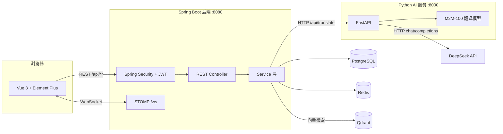

[Uploading README.md…]()
# Transformer 交互式翻译与语言学习平台

一个集 **机器翻译、文本润色、语法纠错、语言学习与语言资产管理** 于一体的前后端分离 Web 平台。

平台以 **M2M-100** 多语种神经翻译模型为核心，叠加 **DeepSeek 大模型** 的润色、评分与批改能力，并配套术语库、向量翻译记忆库、实时协作、学习中心与管理后台，形成「翻译 → 复用 → 反馈 → 修正 → 全站生效」的完整业务闭环。

| | |
|---|---|
| 后端 | Spring Boot 3.2 · Java 17 · Spring Security + JWT · JPA · Redis · WebSocket(STOMP) |
| 前端 | Vue 3.5 · Vite 7 · Element Plus · Pinia · Vue Router · vue-i18n · ECharts |
| AI 服务 | Python 3.10+ · FastAPI · PyTorch · Transformers(M2M-100) · DeepSeek API |
| 存储 | PostgreSQL 15 · Redis 7 · Qdrant 向量数据库 |

---

## 目录

- [功能特性](#功能特性)
- [系统架构](#系统架构)
- [目录结构](#目录结构)
- [快速开始](#快速开始)
  - [环境要求](#环境要求)
  - [方式一：本地开发（推荐）](#方式一本地开发推荐)
  - [方式二：Docker Compose](#方式二docker-compose)
- [配置说明](#配置说明)
- [API 概览](#api-概览)
- [数据库设计](#数据库设计)
- [模型微调](#模型微调)
- [常见问题](#常见问题)
- [已知问题与注意事项](#已知问题与注意事项)
- [安全提示](#安全提示)

---

## 功能特性

### 翻译与文本处理

| 功能 | 说明 |
|---|---|
| 多语种互译 | 中文 / 英语 / 日语 / 韩语 / 法语 / 德语 / 西班牙语，共 7 种语言任意互译 |
| 批量翻译 | 多条文本一次性提交，AI 服务逐条推理并保持顺序返回 |
| 文档翻译 | 上传 `.pdf` / `.docx` / `.md` / `.txt`（≤ 5MB），按段落提取后批量翻译并下载 |
| 智能润色 | 6 种风格：正式 `formal`、口语 `casual`、学术 `academic`、纠错 `grammar`、精炼 `concise`、生动 `vivid` |
| 多版本对比 | 一次生成最多 5 个润色变体，前端基于 `diff` 高亮版本差异 |
| 质量评分 | 从**忠实度 / 流畅度 / 术语准确度**三维度 0–100 打分并给出评语 |
| 词对齐 | 原文—译文词级对齐，支撑前端点击查词 |
| 对话模式 | 双人面对面场景，左右气泡实时互译 |

### 语言资产

| 功能 | 说明 |
|---|---|
| 术语库 Glossary | 用户自定义专业术语（源/目标语言 + 术语对 + 描述），翻译前以占位符形式保护术语不被模型改写 |
| 翻译记忆库 | 基于 **Qdrant** 的相似度检索，命中历史译文可复用；当前向量为 64 维文本哈希向量，可替换为真实 Embedding 模型 |
| 分享卡片 | 译文一键生成可公开访问的分享链接（`/api/public/share/{id}`，无需登录） |
| 翻译历史 | 全量翻译记录检索与分页 |

### 学习中心

| 功能 | 说明 |
|---|---|
| 生词本 | 收藏生词并按**艾宾浩斯遗忘曲线**（`next_review_at`）安排复习 |
| 单词书练习 | CET-4 / CET-6 / TOEFL / IELTS 四套内置词库，随机抽题 + 造句 AI 批改 |
| 分级阅读 | 长文按句切分、逐句对照翻译，并估算 CEFR 难度等级 |
| 语法学习 | 语法检查与句子结构分析 |
| 写作助手 | 文本纠错并输出修改项与修改原因 |
| 每日一句 | 每日推送名言对照，可标记已读并累计学习统计 |

### 协作与管理

| 功能 | 说明 |
|---|---|
| 实时协作 | 基于 STOMP WebSocket 的多房间协同翻译，房间内译文实时同步 |
| 用户体系 | 注册 / 登录 / JWT 鉴权 / 个人资料维护 / 角色（USER、ADMIN） |
| 上报与修正 | 用户提交「不满意译文」，管理员填写修正译文，修正后全站复用 |
| 管理后台 | 用户管理（角色/启停）、全站翻译记录监控、上报处理、数据看板（ECharts） |
| 国际化 | 前端界面中英双语（`zh-CN` / `en-US`），跟随浏览器语言并持久化 |

---

## 系统架构



**一次翻译请求的完整链路（`TranslationService.translate`）：**

1. 前端携带 `Authorization: Bearer <JWT>` 调用 `POST /api/translation`；
2. `JwtAuthenticationFilter` 校验 Token 并注入当前用户；
3. **优先命中已修正的上报**：若存在同一原文、同语种对且状态为 `RESOLVED` 的修正译文，直接返回；
4. **其次查翻译记忆库**：在 Qdrant 中做语义相似检索，原文完全匹配时复用历史译文；
5. **再应用术语库**：把用户术语按长度降序替换为占位符，避免术语被模型改写；
6. **调用 AI 服务**：`RestTemplate` 请求 `POST /api/translate`，由 M2M-100 推理得到译文；
7. **回填与落库**：还原占位符为术语译文，写入 `translation_history`、同步 Qdrant 记忆库、更新学习统计；
8. 若开启 `llm.score.enabled=true`，可额外调用 DeepSeek 生成忠实度/流畅度/术语准确度评分。

---

## 目录结构

```text
GraduatedProject/
├── README.md                          # 本文件
├── Thebody/                           # Spring Boot 后端 + Vue 前端
│   ├── pom.xml
│   ├── src/main/java/com/pan/graduatedproject/
│   │   ├── config/                    # Security / Redis / WebSocket / Async / CORS / AI
│   │   ├── controller/                # REST 接口层（认证、翻译、学习、管理…）
│   │   ├── service/                   # 业务逻辑（AI 调用、缓存、协作、统计…）
│   │   ├── repository/                # Spring Data JPA 仓储
│   │   ├── entity/                    # 14 个实体，对应数据库表
│   │   ├── dto/                       # 请求 / 响应对象
│   │   └── security/                  # JWT 过滤器与 Token Provider
│   ├── src/main/resources/
│   │   ├── application.properties     # 开发环境配置
│   │   ├── application-prod.properties # 生产环境配置（环境变量驱动）
│   │   ├── schema.sql                 # 启动时执行的表结构补丁
│   │   └── wordbooks/                 # CET-4 / CET-6 / TOEFL / IELTS 词库
│   ├── translate-platform/            # Vue 3 前端工程
│   │   ├── src/views/                 # 26 个页面（含 4 个管理端页面）
│   │   ├── src/components/            # 布局与通用 UI 组件
│   │   ├── src/stores/                # Pinia：auth / translation
│   │   ├── src/api/                   # axios 封装与全部接口定义
│   │   ├── src/router/                # 路由与登录/管理员守卫
│   │   ├── src/i18n/ + src/locales/   # 中英国际化
│   │   └── src/utils/stompClient.js   # WebSocket 客户端
│   ├── SQL/all_schema.sql             # 数据库结构导出（参考）
│   ├── deploy/                        # Docker 环境变量 + Nginx 配置
│   ├── docs/                          # 部署文档与检查清单
│   ├── scripts/                       # 一键启动 / 构建脚本
│   └── docker-compose.yml
└── GraduatedProject-AIservice/        # Python AI 服务
    ├── translate_service.py           # FastAPI 入口：翻译 / 润色 / 评分 / 批改
    ├── train_m2m100.py                # M2M-100 微调脚本（opus100 en-zh）
    ├── src/finetune.py                # 微调脚本（早期版本）
    ├── data/train_data.json           # 微调数据样本
    ├── m2m100-finetuned/              # 微调产物（配置 + 分词器）
    ├── scripts/start-ai-service.ps1   # 启动脚本
    ├── requirements.txt
    └── Dockerfile
```

---

## 快速开始

### 环境要求

| 组件 | 版本 | 必需 |
|---|---|---|
| JDK | 17+ | ✅ |
| Maven | 3.8+ | ✅ |
| Node.js | 18+（建议 20） | ✅ |
| Python | 3.10 – 3.12 | ✅ |
| PostgreSQL | 15+ | ✅ |
| Qdrant | 最新版 | 推荐（翻译记忆库） |
| Redis | 7+ | 可选（缓存能力已接入但暂未参与业务，缺失不影响启动） |
| DeepSeek API Key | — | 可选（润色 / 评分 / 批改） |

> Qdrant 不可用时，`TranslationMemoryService` 会捕获异常并返回空结果，翻译主流程不受影响，仅「翻译记忆库相似检索」降级失效。
> 未配置 `DEEPSEEK_API_KEY` 时，翻译与批量翻译仍可用，润色、评分、造句批改接口会返回明确错误。

---

### 方式一：本地开发（推荐）

#### 1. 启动基础服务

```bash
# PostgreSQL：创建数据库
psql -U postgres -c "CREATE DATABASE translatedb;"

# 或者用 Docker 只跑基础设施
docker run -d --name translatedb       -e POSTGRES_PASSWORD=123456 -e POSTGRES_DB=translatedb -p 5432:5432 postgres:15-alpine
docker run -d --name translateredis    -p 6379:6379 redis:7-alpine
docker run -d --name translationqdrant -p 6333:6333 -p 6334:6334 qdrant/qdrant:latest
```

表结构无需手动建：后端启动时会执行 `ddl-auto=update` 与 `schema.sql` 自动补齐。

#### 2. 启动 AI 服务（:8000）

```powershell
cd GraduatedProject-AIservice

# 创建并激活虚拟环境（建议 Python 3.10）
python -m venv .venv
.\.venv\Scripts\Activate.ps1

# 安装依赖（requirements.txt 之外还需补两个包，见「已知问题」）
pip install -r requirements.txt
pip install httpx python-dotenv

# 新建 .env（UTF-8 无 BOM），内容如下；不配置则润色/评分不可用
# DEEPSEEK_API_KEY=sk-你的Key

# 启动
uvicorn translate_service:app --host 0.0.0.0 --port 8000 --reload
```

> 也可直接用脚本启动：`.\scripts\start-ai-service.ps1`。
> `.env` 请使用 UTF-8 无 BOM 保存，否则 `python-dotenv` 可能把 BOM 读进第一个变量名导致 Key 读不到。

- 接口文档：<http://localhost:8000/docs>
- 健康检查：<http://localhost:8000/health>

> **模型说明**：未设置 `MODEL_PATH` 时，服务会自动从 Hugging Face 下载 `facebook/m2m100_418M`（约 1.9GB），首次启动较慢；国内网络建议先设置镜像
> `$env:HF_ENDPOINT = "https://hf-mirror.com"`。
> 若已有本地模型目录，设置 `MODEL_PATH` 指向该目录即可离线加载（目录中必须包含 `model.safetensors` 或 `pytorch_model.bin` 权重文件）。

#### 3. 启动后端（:8080）

```powershell
cd Thebody

# 构建
mvn clean package -DskipTests

# 运行
java -jar target/GraduatedProject-0.0.1-SNAPSHOT.jar
```

开发期也可直接 `mvn spring-boot:run`；或使用 `scripts/start-backend.ps1`。

- 健康检查：<http://localhost:8080/api/public/health>
- 默认数据库账号为 `postgres / 123456`，如不同请修改 `src/main/resources/application.properties`

#### 4. 启动前端（:5173）

```powershell
cd Thebody\translate-platform
npm install
npm run dev
```

访问 <http://localhost:5173>，前端默认请求 `http://localhost:8080/api`（由 `.env` 中的 `VITE_API_BASE_URL` 控制）。

生产构建：`npm run build`，产物输出至 `translate-platform/dist`。

---

### 方式二：Docker Compose

`Thebody/docker-compose.yml` 定义了 PostgreSQL、Redis、Qdrant、AI 服务、后端、前端共 6 个容器，前端通过 Nginx 暴露 80 端口。

```bash
cd Thebody

# Windows
copy deploy\.env.docker .env
# Linux / macOS
cp deploy/.env.docker .env

# 修改 .env 中的 JWT_SECRET 等敏感项后启动
docker compose up -d --build

docker compose ps        # 查看状态
docker compose logs -f   # 查看日志
docker compose down      # 停止
```

启动后可访问：

| 服务 | 地址 | 说明 |
|---|---|---|
| 前端（Nginx） | <http://localhost> | 唯一对外暴露的端口（80） |
| 后端 API | <http://localhost/api> | 由前端 Nginx 反代到 `backend:8080` |
| WebSocket | `ws://localhost/ws` | 由前端 Nginx 升级转发 |

> 后端 8080、AI 8000、Qdrant 6333 在 compose 中**未映射到宿主机**，只能在同一 `translation-network` 内互相访问。若需从宿主调试，请自行补充 `ports` 映射。
>
> ⚠️ 当前 `docker-compose.yml` 的 `depends_on` 写法存在 YAML 语法错误，直接启动会失败，修复方法见 [已知问题](#已知问题与注意事项)。
>
> 数据库口令在 compose 中硬编码为 `postgres / postgres`，与 `.env` 中的 `DB_PASSWORD` 并不联动，修改时需同时调整两处。

生产环境反向代理可参考 `deploy/nginx/translation.conf`（API 反代 + AI 反代 + 长超时）与 `translate-platform/nginx.conf`（SPA history 路由 + `/ws` WebSocket 升级）。

---

## 配置说明

### 后端 `application.properties`

| 配置项 | 默认值 | 说明 |
|---|---|---|
| `server.port` | `8080` | 服务端口 |
| `spring.datasource.url` | `jdbc:postgresql://localhost:5432/translatedb` | 数据库连接 |
| `spring.datasource.username` / `password` | `postgres` / `123456` | 数据库账号 |
| `spring.jpa.hibernate.ddl-auto` | `update` | 自动建表/更新表结构 |
| `spring.sql.init.mode` | `always` | 每次启动执行 `schema.sql` 补丁 |
| `jwt.secret` | 内置默认值 | **生产环境必须替换** |
| `jwt.expiration` | `86400000` | Token 有效期（毫秒，24 小时） |
| `ai.service.url` | `http://localhost:8000` | Python AI 服务地址 |
| `ai.service.timeout` | `30000` | AI 调用超时（毫秒） |
| `qdrant.host` / `port` | `localhost` / `6333` | 向量库地址 |
| `qdrant.collection.name` | `translation_memory` | 记忆库集合名 |
| `spring.data.redis.host` / `port` | `localhost` / `6379` | 缓存 |
| `llm.score.enabled` | `false` | 是否启用 OpenAI 兼容模型评分通道 |
| `llm.score.provider` | `mock` | 设为 `openai_compatible` 并补齐 `base-url` / `api-key` / `model` 后改走自定义模型 |

质量评分的降级顺序为：**OpenAI 兼容模型**（需 `llm.score.enabled=true` 且四项配置齐全）→ **AI 服务的 DeepSeek 评分** → **本地启发式评分**，任一步失败自动回退。

生产环境使用 `application-prod.properties`（`SPRING_PROFILES_ACTIVE=prod`），全部敏感项由环境变量注入：`DB_HOST`、`DB_PORT`、`DB_NAME`、`DB_USER`、`DB_PASSWORD`、`REDIS_HOST`、`REDIS_PORT`、`QDRANT_HOST`、`QDRANT_PORT`、`AI_SERVICE_URL`、`JWT_SECRET`、`JWT_EXPIRATION`。完整示例见 `Thebody/.env.example`。

### AI 服务 `.env`

| 变量 | 默认值 | 说明 |
|---|---|---|
| `DEEPSEEK_API_KEY` | 无 | DeepSeek 密钥，缺失时润色/评分/批改接口返回 500 |
| `DEEPSEEK_BASE_URL` | `https://api.deepseek.com/v1` | OpenAI 兼容接口地址 |
| `MODEL_PATH` | 无 | 本地模型目录，为空则在线下载 `facebook/m2m100_418M` |
| `TORCH_NUM_THREADS` | `2` | PyTorch 线程数（CPU 环境建议 2–4） |
| `MAX_LENGTH` | `256` | 生成译文最大 token 数 |

### 前端 `.env`

| 变量 | 说明 |
|---|---|
| `VITE_API_BASE_URL` | 后端 API 根地址，默认 `http://localhost:8080/api`；生产环境示例见 `.env.production` |

---

## API 概览

统一前缀 `http://localhost:8080/api`，除标记为「公开」的接口外均需请求头 `Authorization: Bearer <token>`。

除文档下载（返回文件流）与 `/api/public/*` 外，响应体统一为 `{ "success": boolean, "message": string, "data": any }`。

**调用示例**

```bash
# 1) 登录获取 JWT
curl -X POST http://localhost:8080/api/auth/login \
  -H "Content-Type: application/json" \
  -d '{"username":"demo","password":"123456"}'
# => {"success":true,"message":"Login successful","data":{"token":"eyJ...","username":"demo","role":"USER"}}

# 2) 携带 Token 翻译
curl -X POST http://localhost:8080/api/translation \
  -H "Content-Type: application/json" \
  -H "Authorization: Bearer <token>" \
  -d '{"sourceText":"Hello world","sourceLang":"en","targetLang":"zh"}'
```

翻译请求体字段为 `sourceText`（必填）、`sourceLang`（默认 `zh`）、`targetLang`（默认 `en`）、`context`（可选上下文）、`translationType`。

### 认证与用户

| 方法 | 路径 | 说明 |
|---|---|---|
| POST | `/auth/register` | 注册（公开） |
| POST | `/auth/login` | 登录，返回 JWT（公开） |
| GET | `/user/me` | 当前用户资料 |
| PUT | `/user/me` | 修改昵称等资料 |

### 翻译与润色

| 方法 | 路径 | 说明 |
|---|---|---|
| POST | `/translation` | 单段文本翻译 |
| POST | `/translation/batch` | 批量翻译 |
| GET | `/translation/history` | 翻译历史 |
| POST | `/polish` | 单版本润色 |
| POST | `/polish/variants` | 多版本润色（1–5 个） |
| GET | `/polish/history` | 润色历史 |
| POST | `/quality/score` | 译文质量三维评分 |
| GET | `/quality/history` | 评分历史 |
| POST | `/document/translate` | 文档翻译（`multipart/form-data`，返回文件流） |
| POST | `/word-align` | 词级对齐 |

### 语言资产

| 方法 | 路径 | 说明 |
|---|---|---|
| GET | `/glossary` | 术语库列表（分页/筛选） |
| POST | `/glossary` | 新增术语 |
| PUT | `/glossary/{id}` | 更新术语 |
| DELETE | `/glossary/{id}` | 删除术语 |
| GET | `/memory/search` | 向量记忆库语义检索（`query`、`limit`…） |
| POST | `/memory` | 写入记忆库 |
| DELETE | `/memory/{id}` | 删除记忆条目 |
| POST | `/share` | 生成分享卡片 |
| GET | `/public/share/{id}` | 读取分享内容（公开） |

### 学习中心

| 方法 | 路径 | 说明 |
|---|---|---|
| POST | `/vocab/add` | 收藏生词 |
| GET | `/vocab/due` | 到期复习队列 |
| POST | `/vocab/review` | 提交复习结果（更新掌握度与下次复习时间） |
| GET | `/wordbook/books` | 词书列表（cet4/cet6/toefl/ielts） |
| GET | `/wordbook/next` | 抽取下一个单词 |
| POST | `/wordbook/evaluate` | 造句 AI 批改 |
| POST | `/grammar/check` | 语法检查 |
| POST | `/grammar/parse` | 句子结构分析 |
| POST | `/reading/prepare` | 分级阅读材料准备（逐句对照翻译） |
| POST | `/writing/analyze` | 写作纠错与修改说明 |
| POST | `/daily/read/{id}` | 标记每日一句已读 |
| GET | `/help/faqs` | 帮助中心 FAQ |

### 协作与统计

| 方法 | 路径 | 说明 |
|---|---|---|
| POST | `/collaboration/rooms` | 创建协作房间 |
| GET | `/collaboration/rooms` | 房间列表 |
| GET | `/collaboration/rooms/{id}` | 房间详情 |
| POST | `/collaboration/rooms/{id}/join` | 加入房间 |
| POST | `/collaboration/rooms/{id}/leave` | 离开房间 |
| POST | `/reports` | 上报不满意译文 |
| GET | `/stats/dashboard` | 个人学习统计看板 |

### 管理端（需 `ADMIN` 角色）

| 方法 | 路径 | 说明 |
|---|---|---|
| GET | `/admin/history` | 全站翻译记录（分页 + 筛选） |
| GET | `/admin/users` | 用户列表 |
| PUT | `/admin/users/{id}/role` | 修改用户角色 |
| PUT | `/admin/users/{id}/enabled` | 启用 / 禁用用户 |
| GET | `/admin/reports` | 上报列表 |
| PUT | `/admin/reports/{id}` | 处理上报（填写修正译文） |
| GET | `/admin/stats/dashboard` | 全站统计看板 |

### 公开接口

| 方法 | 路径 | 说明 |
|---|---|---|
| GET | `/public/health` | 健康检查 |
| GET | `/public/languages` | 支持的语言列表 |
| GET | `/public/daily` | 每日一句 |

### WebSocket

| 项 | 值 |
|---|---|
| 端点 | `ws://localhost:8080/ws` |
| 协议 | 原生 WebSocket 上自行实现的 STOMP 1.2 帧（`src/utils/stompClient.js`，未依赖 SockJS） |
| 应用前缀 | `/app` |
| 订阅前缀 | `/topic` |
| 鉴权 | 握手时由 `WsJwtHandshakeInterceptor` 校验 `?token=<JWT>` 查询参数或请求头 |

### AI 服务接口（:8000）

| 方法 | 路径 | 说明 |
|---|---|---|
| GET | `/health` | 健康检查 |
| GET | `/api/languages` | 支持语言 |
| POST | `/api/translate` | M2M-100 单段翻译（别名 `/translate`） |
| POST | `/api/translate/batch` | 批量翻译 |
| POST | `/api/polish` | DeepSeek 单版本润色 |
| POST | `/api/polish/variants` | DeepSeek 多版本润色 |
| POST | `/api/quality/score` | 三维质量评分 |
| POST | `/api/learn/sentence-check` | 英语造句批改 |

请求示例：

```bash
curl -X POST http://localhost:8000/api/translate \
  -H "Content-Type: application/json" \
  -d '{"text":"今天天气很好","src_lang":"zh","tgt_lang":"en"}'
# => {"status":"success","data":"<译文>"}
```

---

## 数据库设计

后端 14 个 JPA 实体对应以下表（由 `ddl-auto=update` + `schema.sql` 自动创建）：

| 表名 | 说明 |
|---|---|
| `users` | 用户（用户名、邮箱、BCrypt 密码、昵称、角色、启用状态） |
| `translation_history` | 翻译历史（原文/译文/语种对/翻译类型/上下文） |
| `polish_history` | 润色历史 |
| `translation_report` | 不满意译文上报（`OPEN` / `RESOLVED`、用户评论、管理员修正与备注） |
| `translation_rating` | 译文点赞/评分 |
| `translation_memory` | 翻译记忆库记录（与 Qdrant 向量联动） |
| `term_glossary` | 用户术语库 |
| `vocab` | 生词本（掌握度 `mastery`、下次复习时间 `next_review_at`） |
| `daily_sentences` | 每日一句 |
| `daily_sentence_read_record` | 每日一句阅读记录 |
| `learning_statistics` | 学习统计汇总 |
| `share_card` | 分享卡片 |
| `collab_room` | 协作房间 |
| `collab_participant` | 房间成员 |

实体关系核心：`users` 一对多关联 `translation_history`、`vocab`、`term_glossary`、`translation_report`、`collab_room`，全部以 `user_id` 外键约束。完整 DDL 参考 `Thebody/SQL/all_schema.sql`。

---

## 模型微调

AI 服务在 `facebook/m2m100_418M` 基础上支持中英双向微调。

```bash
cd GraduatedProject-AIservice

# 微调依赖
pip install datasets accelerate sentencepiece

# 开始微调（opus100 en-zh 数据集 10% 子集，双向，2 epoch）
python train_m2m100.py
```

脚本默认参数：

| 参数 | 值 |
|---|---|
| 基座模型 | `facebook/m2m100_418M` |
| 数据集 | `opus100` `en-zh`（`train[:10%]`，训练/验证 9:1） |
| 最大输入/输出长度 | 256 / 256 |
| batch size | 3 |
| 学习率 | 5e-5 |
| epoch | 2 |
| 输出目录 | `./m2m100-finetuned` |

训练完成后设置 `MODEL_PATH=./m2m100-finetuned` 启动服务即可离线加载。仓库内的 `m2m100-finetuned/` 目前只包含配置与分词器文件，权重文件需自行训练后放入。

---

## 常见问题

**Q1：AI 服务启动卡在下载模型？**
首次启动需要下载 `facebook/m2m100_418M`（约 1.9GB）。国内网络建议先设置 `$env:HF_ENDPOINT = "https://hf-mirror.com"` 再启动；或提前将模型权重放到 `MODEL_PATH` 指定目录。

**Q2：润色 / 评分接口返回 500 或「DEEPSEEK_API_KEY is not configured」？**
`GraduatedProject-AIservice/.env` 中未配置有效 Key。填入 `DEEPSEEK_API_KEY` 后重启 AI 服务。

**Q3：后端启动报数据库连接失败？**
确认 PostgreSQL 已启动且 `translatedb` 库存在，并核对 `application.properties` 中的账号密码（默认 `postgres / 123456`）。

**Q4：前端页面空白或请求 401？**
`VITE_API_BASE_URL` 指向的后端未启动，或本地 Token 已过期。清除 `localStorage` 中的 `token` / `user` 后重新登录。

**Q5：跨域被拦截？**
后端 `CorsConfig` / `SecurityConfig` 已放开 `*` 来源，生产环境建议改为具体域名。

**Q6：翻译记忆库搜不到结果？**
需要 Qdrant 运行在 `qdrant.host:qdrant.port` 且集合 `translation_memory` 已创建；未安装 Qdrant 时该功能自动降级不可用，不影响翻译主流程。

---

## 已知问题与注意事项

以下是当前代码中可以直接复现的问题，使用前建议先处理：

1. **`docker-compose.yml` 语法错误**：`backend.depends_on` 同时混用了映射与列表写法，`docker compose up` 会直接报 YAML 解析错误。修改为纯映射形式即可：
   ```yaml
   depends_on:
     postgres:
       condition: service_healthy
     redis:
       condition: service_healthy
     qdrant:
       condition: service_started
     ai-service:
       condition: service_started
   ```

2. **`requirements.txt` 依赖不全**：`translate_service.py` 导入了 `httpx` 与 `python-dotenv`，但两个包未列入依赖清单，`pip install -r requirements.txt` 后直接启动会 `ModuleNotFoundError`。补充安装 `pip install httpx python-dotenv`，或添加到 `requirements.txt`。

3. **语法检查接口无对应实现**：`GrammarService` 请求 AI 服务的 `/grammar/check` 与 `/grammar/parse`，但 `translate_service.py` 未提供这两个路由，调用会返回 404。语法学习模块需补实现或改接其他能力。

4. **写作助手与阅读难度为规则实现**：`WritingAssistantService` 目前基于正则做空格规整、`i has → I have` 等少量规则修正；`ReadingService` 按文本长度估算难度等级。两者返回的 `source` 均为 `mock`，可自行替换为大模型实现。

5. **`.env` 文件被提交入库**：`GraduatedProject-AIservice/.env` 中含真实 DeepSeek Key，且仓库根目录缺少 `.gitignore`。请立即轮换该 Key，并将 `.env`、`target/`、`node_modules/`、`.venv/`、`m2m100-finetuned/` 等加入忽略列表。

6. **`docker-compose.yml` 挂载路径已失效**：AI 服务挂载 `../GraduatedProject-AIservice/models` 与 `MODEL_PATH=/app/models/m2m100_418M`，但该目录已不在仓库中，容器内会回退为在线下载模型。按实际模型目录调整挂载即可。

7. **`scripts/` 下部分脚本为 GBK 编码**：在 UTF-8 终端直接查看可能显示乱码，用 Windows PowerShell 5.x 执行不受影响。

---

## 安全提示

- 生产部署**必须**替换 `jwt.secret`（建议 64 位以上随机字符串），仓库中的默认值仅用于本地开发。
- CORS 当前放开全部来源，上线前请收紧为实际前端域名。
- 数据库默认口令 `123456` 仅用于本地开发，生产环境请通过环境变量注入强口令。
- 请不要把 `DEEPSEEK_API_KEY`、数据库密码等敏感信息提交到 Git；推荐使用 `.env` + `.gitignore` 或配置中心。
- 上传文件限制为 5MB，生产环境建议同时在 Nginx 层限制 `client_max_body_size` 并做文件类型白名单校验。

---

## 文档

| 文档 | 内容 |
|---|---|
| `Thebody/docs/DEPLOYMENT.md` | 完整部署指南（本地 / Docker / 云服务 / Nginx / 备份） |
| `Thebody/docs/DEPLOYMENT_CHECKLIST.md` | 上线检查清单 |
| `.trae/documents/project-full-spec.md` | 需求与设计全量说明（架构、用例、DFD、E-R） |
| `.trae/documents/user-guide.md` | 最终用户使用指南 |
| `.trae/documents/api-specification.md` | 接口说明 |

---

## 作者

**PanJunJeah** — GitHub: <https://github.com/PanJunJeah/GraduatedProject>

本项目为毕业设计作品，仅用于学习与研究。
